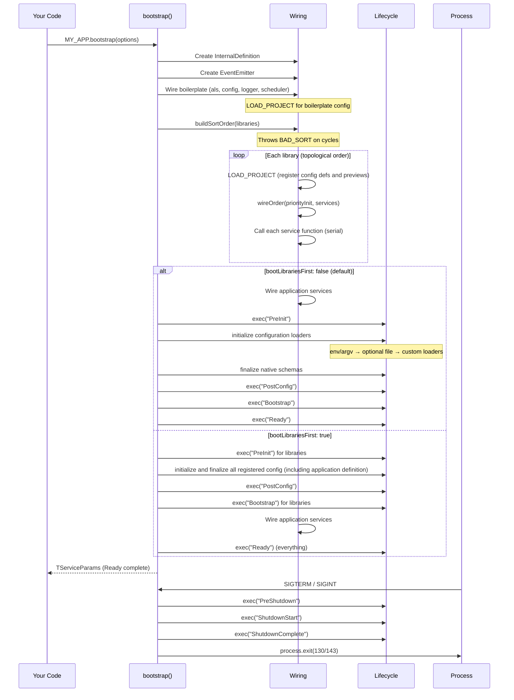

When you call `MY_APP.bootstrap()`, core wires the dependency graph before the first `onReady` callback. This guide focuses on where configuration enters that sequence.

## The full sequence

## Phase 1 — Boilerplate

Before user services run, four boilerplate services are wired: `als`, `configuration`, `logger`, and `scheduler`. They form the basis of `TServiceParams`.

The boilerplate config definitions are registered before library code runs. Legacy defaults are populated immediately. If a TypeBox entry has an explicit root default, core can prepare an isolated construction preview; a known bootstrap value can supersede it. External loaders have not run.

## Phase 2 — Dependency sorting

`buildSortOrder()` performs a topological sort on `app.libraries`. It selects the next library whose dependencies are already in the output list. A `BAD_SORT` error means the dependency graph is circular.

If `appendLibrary` was passed in `BootstrapOptions`, those libraries are merged before sorting.

## Phase 3 — Library wiring

Libraries wire in topological order. For each library:

1. `LOAD_PROJECT` registers its config definitions and validates the entry/provider shape.
2. Schema metadata is recorded without executing provider callbacks; root TypeBox defaults may be prepared for the construction preview.
3. `wireOrder(priorityInit, services)` determines the service order.
4. Each service function is called once with the services wired so far.

During wiring, `config.*` does not contain final external values. A service may see legacy defaults, a TypeBox root-default preview, a known bootstrap value, or raw values made visible by earlier setup. It must wait for `onPostConfig` for provider-processed output.

## Phase 4 — Application wiring

The application's services wire after its libraries in the default mode. The application definition is registered in the same way, and its bootstrap configuration seed is available before its service factories run. With `bootLibrariesFirst: true`, application wiring is deferred until after library Bootstrap callbacks.

## Phase 5 — Configuration and lifecycle

After all services are wired, core runs `PreInit`. This is the last early stage for registering custom loaders. Configuration initialization then runs:

1. the env/argv loader, with argv winning when both provide a value;
2. the file loader only when `configSources.file` is true;
3. registered custom loaders in registration order, skipping names explicitly set to false;
4. native schema processing and legacy finalization.

Bootstrap configuration is an early seed in this process. It is not a highest-priority override, and an entry's `source` allow-list filters loader values rather than explicit bootstrap input.

For schema entries, all raw sources settle before provider processing. TypeBox object, record, and array roots parse winning string values as JSON; normal strings remain strings. Core publishes one complete processed snapshot atomically. A provider or legacy required failure aborts before `PostConfig`.

`PostConfig` is therefore the first stage where all `config.*` values are final. `Bootstrap` is the main initialization stage, and `Ready` is the point where the application is fully started.

## What's in RAM at Ready

At `Ready`, every service's return value is accessible. `internal.boot.loadedModules` contains all modules and service APIs, and `internal.boot.completedLifecycleEvents` contains `PreInit`, `PostConfig`, `Bootstrap`, and `Ready`.

No service function is called again. The dependency graph is fixed. Runtime `configuration.set()` and `merge()` updates change the live output-shaped store; they do not re-run native schema decoding or validation.

## Shutdown

Shutdown is triggered by `SIGTERM`, `SIGINT`, or `app.teardown()`:

1. Active `sleep()` calls are killed.
2. `PreShutdown`, `ShutdownStart`, and `ShutdownComplete` run in order.
3. Event listeners are removed.
4. Signal-triggered shutdown exits with 143 (`SIGTERM`) or 130 (`SIGINT`).

A bootstrap failure exits with 1 in normal app mode. A clean teardown without a signal lets the Node.js process exit naturally.

## Why wiring is separate from lifecycle

During wiring, service functions run and return their APIs. `TServiceParams` is built incrementally, so services can only read APIs from modules already wired. Lifecycle callbacks run after the graph is constructed, when ordering and service APIs are stable.

Keeping wiring and lifecycle separate lets `priorityInit`, `depends`, and `libraries` control construction order without conflating construction with async initialization. Configuration follows the same boundary: previews may support construction, while final provider output is guaranteed only from `PostConfig` onward.
