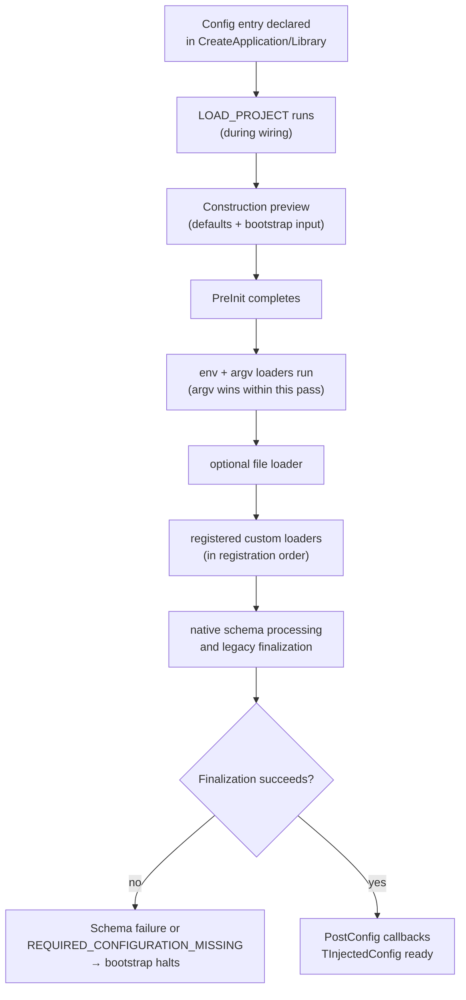

## The full config flow



## Source priority

Core starts each key with declaration defaults and `bootstrap.configuration` as early input. It then settles the enabled loaders in this order:

1. **declaration defaults / bootstrap inputs**
2. **env / argv** — environment variables and CLI flags; a matching CLI value wins within this pass
3. **optional file loader**
4. **registered custom loaders** — registration order
5. **native schema processing and legacy finalization**
6. **`onPostConfig`** — the complete processed snapshot is available

An enabled later loader can replace an earlier input; `bootstrap.configuration` is not a highest-priority override. Schema keys are replaced atomically during final processing, while legacy values retain their historical merge behavior. Normal bootstrap enables `env` and `argv` by default; the file loader is opt-in with `configSources.file: true`.

## Environment variable format

```
MODULE_NAME__KEY_NAME=value
```

Both the module name and key name are all uppercase, separated by a double underscore (`__`).

| Config entry | Env var |
|---|---|
| `my_app.DATABASE_URL` | `MY_APP__DATABASE_URL` |
| `my_lib.BASE_URL` | `MY_LIB__BASE_URL` |
| `boilerplate.LOG_LEVEL` | `BOILERPLATE__LOG_LEVEL` |

The single-underscore form (`MY_APP_DATABASE_URL`) and a bare key (`DATABASE_URL`, no module prefix) are also accepted as fallbacks — see [Lookup precedence](../reference/config/sourcing.md#lookup-precedence) in the reference. The same forms apply to CLI switches; use `--my_app__PORT=8080`, not dot notation such as `--my_app.PORT=8080`. Prefer the double-underscore form: it's unambiguous when module names contain underscores.

## Multi-environment patterns

Use `bootstrap.configuration` for environment-specific early baseline values, and rely on environment variables for per-deployment values. Enabled loaders may override that bootstrap seed.

```typescript title="src/main.mts  (production)"
await MY_APP.bootstrap({
  configuration: {
    boilerplate: { LOG_LEVEL: "warn" },
    my_app: { ENVIRONMENT: "production" },
  },
});
```

```typescript title="src/dev.mts  (development)"
await MY_APP.bootstrap({
  configuration: {
    boilerplate: { LOG_LEVEL: "debug" },
    my_app: { ENVIRONMENT: "local", PORT: 3001 },
  },
});
```

```bash
# In production, real values come from environment:
MY_APP__DATABASE_URL=postgres://prod-db/myapp
MY_APP__API_KEY=real-key
```

```bash
# In development, .env file provides local values:
MY_APP__DATABASE_URL=postgres://localhost/dev
MY_APP__API_KEY=dev-test-key
```

## Secret management

For a legacy `type` entry, use `required: true` without a `default` for secrets. This gives a clear boot failure if the secret is missing:

```typescript
// Legacy entry form:
DATABASE_URL: {
  type: "string",
  required: true,
  // no default
},
API_KEY: {
  type: "string",
  required: true,
},
```

Schema entries express requiredness through the provider, for example `API_KEY: { schema: Type.String() }`; they do not use the outer `required` flag.

In production: inject secrets via environment variables (`MY_APP__DATABASE_URL=...`). Don't hardcode secrets in config files or `bootstrap.configuration`.

In tests, disable host sources explicitly and provide test values via `.configure()`:

```typescript
await TestRunner({ target: MY_APP })
  .setOptions({ configSources: { env: false, argv: false, file: false } })
  .configure({
    my_app: {
      DATABASE_URL: "postgres://localhost/test",
      API_KEY: "test-key",
    },
  })
  .run();
```

## Restricting config sources

Use `source: ["env"]` on sensitive entries to restrict loader values to environment variables — not a config file committed to version control:

```typescript
SECRET_KEY: {
  type: "string",
  required: true,
  source: ["env"],  // filters loader values; bootstrap/set/merge remain separate
}
```

The allow-list does not block an explicit bootstrap seed or the output-shaped `set()` and `merge()` APIs.

## Config in tests

`TestRunner` forwards `configSources` to bootstrap. Normal bootstrap enables `env` and `argv` by default and keeps the file loader opt-in, so tests that must be isolated from the host should disable every built-in channel explicitly:

```typescript
// In test: required entries must be provided explicitly
await TestRunner({ target: MY_APP })
  .setOptions({ configSources: { env: false, argv: false, file: false } })
  .configure({
    my_app: { DATABASE_URL: "postgres://test", API_KEY: "test" },
  })
  .run(async ({ config, lifecycle }) => {
    lifecycle.onPostConfig(() => {
      // config.my_app.DATABASE_URL === "postgres://test"
      void config.my_app.API_KEY;
    });
  });
```

With those channels disabled, values come from defaults or `.configure()`, making the test deterministic regardless of the environment.

## Reacting to runtime config changes

If you use programmatic config updates (e.g., feature flags from a config service), subscribe to changes:

```typescript
export function FeatureService({ config, internal, lifecycle }: TServiceParams) {
  lifecycle.onBootstrap(() => {
    internal.boilerplate.configuration.onUpdate((project, property) => {
      if (project === "my_app" && property === "FEATURE_FLAGS") {
        updateFeatureFlags(config.my_app.FEATURE_FLAGS);
      }
    });
  });
}
```

Updates emit `"event_configuration_updated"` on the event bus and trigger `onUpdate` callbacks.
