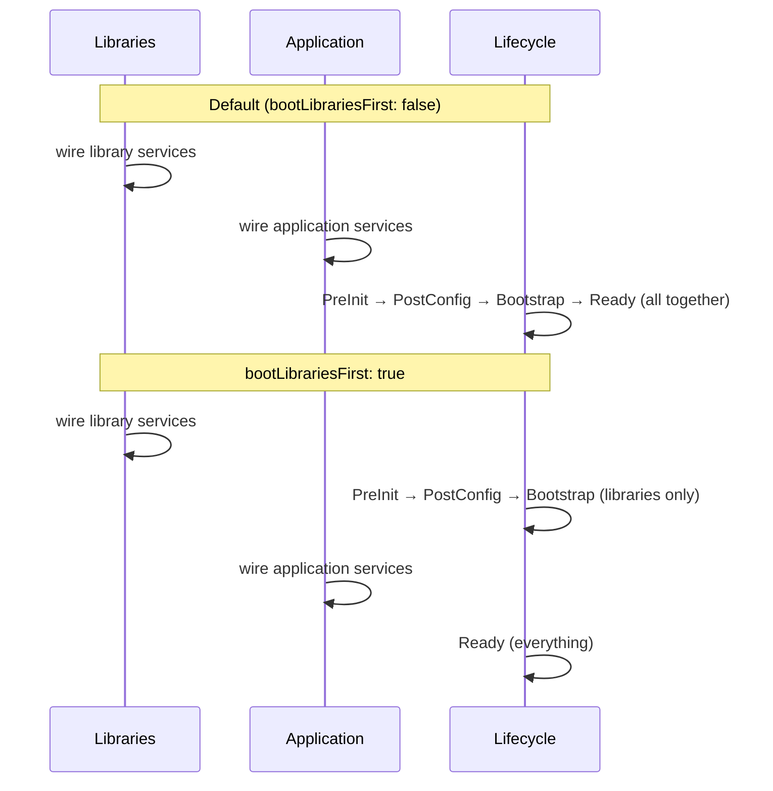

`bootstrap()` accepts an optional `BootstrapOptions` object. All fields are optional.

```typescript
await MY_APP.bootstrap({
  configuration: { boilerplate: { LOG_LEVEL: "debug" } },
  configSources: { file: false },
  bootLibrariesFirst: true,
  loggerOptions: { mergeData: { env: "production" } },
});
```

## Options reference

| Field | Type | Default | Description |
|---|---|---|---|
| `configuration` | input-shaped partial configuration | — | Early schema/legacy input seed; later enabled loaders can override it |
| `bootLibrariesFirst` | `boolean` | `false` | Boot libraries through Bootstrap before wiring app services |
| `appendLibrary` | `TLibrary \| TLibrary[]` | — | Add extra libraries after construction |
| `appendService` | `ServiceMap` | — | Add extra services to the application |
| `loggerOptions` | `LoggerOptions` | — | Fine-tune the built-in logger |
| `customLogger` | `GetLogger` | — | Replace the built-in logger entirely |
| `handleGlobalErrors` | `boolean` | `true` | Reserved for host-level error handling behavior |
| `showExtraBootStats` | `boolean` | `false` | Print per-service construction times after boot |
| `envFile` | `string` | `".env"` | Select the dotenv file used by environment loading |
| `configSources` | `Partial<Record<DataTypes, boolean>>` | env/argv on, file off | Enable or disable individual loader channels |

### `configuration`

`configuration` is an input-shaped seed applied while module definitions are registered, before the source loaders run. For schema entries, its value type is the provider input type. It is not a highest-priority override: enabled environment, argv, file, or custom loaders can replace it.

```typescript
import { Type } from "typebox";
import { CreateApplication } from "@digital-alchemy/core";

const MY_APP = CreateApplication({
  name: "my_app",
  configuration: {
    RETRIES: { schema: Type.Integer({ default: 3 }) },
  },
  services: {},
});

await MY_APP.bootstrap({
  configuration: {
    my_app: { RETRIES: 5 },
  },
});
```

A schema transform or codec may accept a different input type than the output eventually injected into `config`. See [Schema-backed Configuration](../config/schemas.mdx#input-and-output-types).

### `configSources`

Normal bootstrap enables the `env` and `argv` loaders by default. The `file` loader is opt-in. Custom loader names are enabled unless explicitly set to `false`:

```typescript
await MY_APP.bootstrap({
  configSources: {
    env: true,
    argv: false,
    file: true,
    remote: false,
  },
});
```

These switches control loader channels, not explicit `configuration` values or the output-shaped `set()` and `merge()` APIs. An entry-level `source` allow-list further restricts which loader can set that key.

The file loader reads JSON, YAML/YML, and INI. Select its path with `--config path` or the legacy `boilerplate.CONFIG` input. It is separate from dotenv loading: `envFile` and `--env-file` select a dotenv file that populates `process.env` for the environment loader.

For source precedence and key lookup, see [Config Sourcing](../config/sourcing.md).

### `bootLibrariesFirst`

By default, all services (library and application) are wired first, then lifecycle stages run for everything together. With `bootLibrariesFirst: true`, the sequence changes:



Use `bootLibrariesFirst: true` when application services need library resources to be established before their own service function body runs.

### `appendLibrary` / `appendService`

These options add libraries or services that were not declared in the original `CreateApplication` call. They are useful for test helpers, plugins, and runtime extensions. A same-name appended library replaces the existing library.

### `loggerOptions`

Fine-tune the built-in logger without replacing it. See [Project Tuning](../../advanced/project-tuning.md) for the field reference.

```typescript
loggerOptions: {
  mergeData: { env: process.env.NODE_ENV, host: hostname() },
  ms: true,
  counter: false,
}
```

### `customLogger`

Replace the built-in logger with your own `GetLogger` implementation. This is useful for integrating with an external logging system.

## Process exit codes

The framework registers `SIGTERM` and `SIGINT` handlers. On signal receipt it runs the shutdown sequence before exiting:

| Event | Exit code |
|---|---|
| Bootstrap error in normal app mode | `1` (`EXIT_ERROR`) |
| `SIGINT` (Ctrl+C) | `130` |
| `SIGTERM` | `143` |

Normal application exit does not call `process.exit()`; Node exits naturally after lifecycle callbacks and resources finish.

## Common errors

| Error cause | What it means |
|---|---|
| `DOUBLE_BOOT` | `bootstrap()` was called on an already-running application |
| `BAD_SORT` | A circular dependency exists between libraries |
| `MISSING_DEPENDENCY` | A library dependency is not in the application graph |
| `MISSING_PRIORITY_SERVICE` | A name in `priorityInit` is not in `services` |
| `REQUIRED_CONFIGURATION_MISSING` | A legacy `required: true` entry is undefined after loading |
| `CONFIG_SCHEMA_INVALID` | A winning schema input is missing or fails native validation |
| `CONFIG_SCHEMA_PROCESSING_FAILED` | A schema provider operation failed |
| `CONFIG_SCHEMA_PEER_MISSING` / `CONFIG_SCHEMA_PEER_BROKEN` | TypeBox cannot be loaded or its value surface is unusable |

Schema entries do not use `CONFIG_SCHEMA_REQUIRED`; a missing bare schema value is reported as `CONFIG_SCHEMA_INVALID`. See [Schema failures](../config/schemas.mdx#schema-failures).
